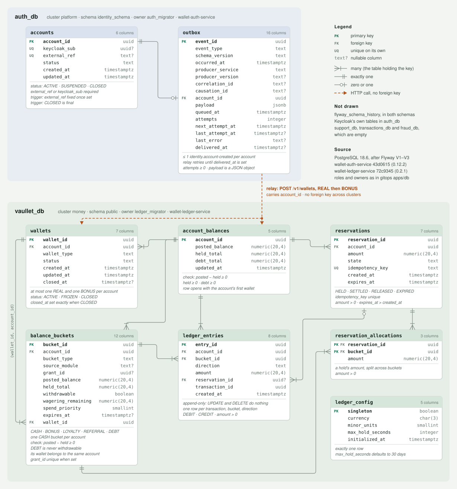

# Database schema

The two databases the deployed services migrate, as Flyway leaves them.

| Database | Cluster | Schema | Tables owned by | Service |
| --- | --- | --- | --- | --- |
| `auth_db` | `platform` | `identity_schema` | `auth_migrator` | wallet-auth-service |
| `vaullet_db` | `money` | `public` | `ledger_migrator` | wallet-ledger-service |

<picture>
  <source media="(prefers-color-scheme: dark)" srcset="erd-dark.svg">
  
</picture>

**One link crosses between them, and it is not a foreign key.** The auth service writes each new
account's `identity.account-created` event to `identity_schema.outbox` in the same transaction as the
account. Its outbox relay then calls the ledger's `POST /v1/wallets` with that `account_id`, `REAL`
then `BONUS`, and the ledger opens the wallets and the `account_balances` row under the same id. The
two databases are in different clusters, so nothing in either one references the other; the relay
retries an event until it is delivered.

**Not drawn:** `flyway_schema_history`, in both schemas; Keycloak's own tables in `auth_db`;
`support_db`, `transactions_db` and `fraud_db`, which are empty.

Each service has the full description of its own schema — every column, constraint, index, trigger,
rule and grant — generated from a real database:

- [wallet-auth-service `docs/schema/`](https://github.com/vaullet-dev/wallet-auth-service/tree/master/docs/schema)
- [wallet-ledger-service `docs/schema/`](https://github.com/vaullet-dev/wallet-ledger-service/tree/master/docs/schema)

**Source:** PostgreSQL 18.6 after Flyway V1–V3, at wallet-auth-service `43d0615` (0.12.2) and
wallet-ledger-service `72c9345` (0.2.1), with roles and owners as gitops `apps/db` declares them.
